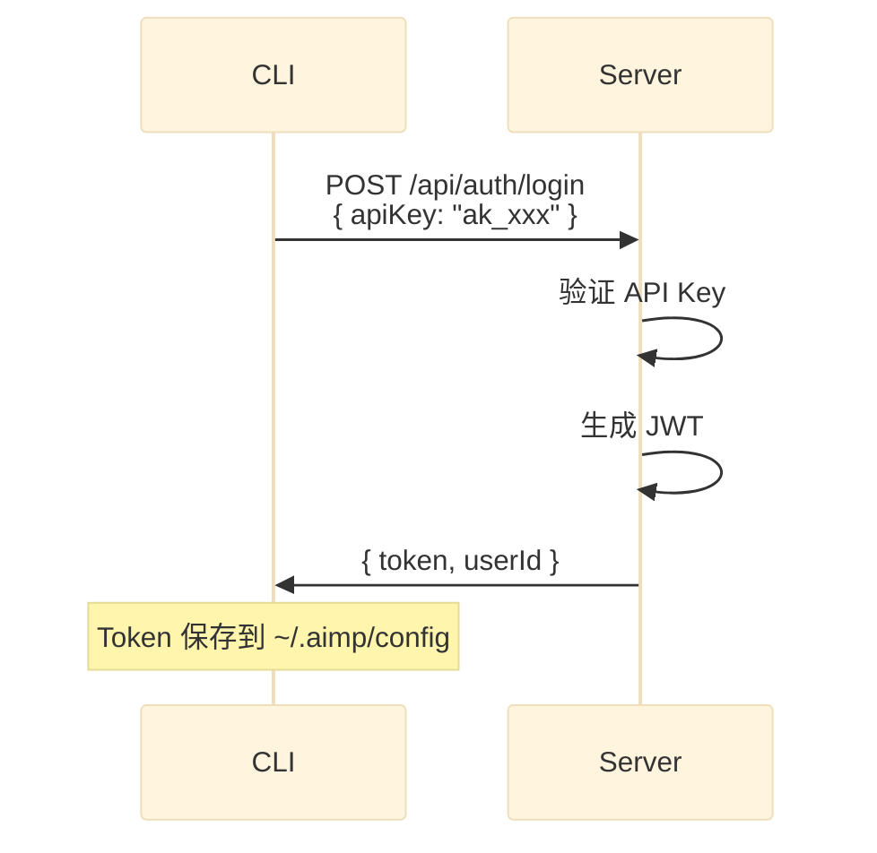
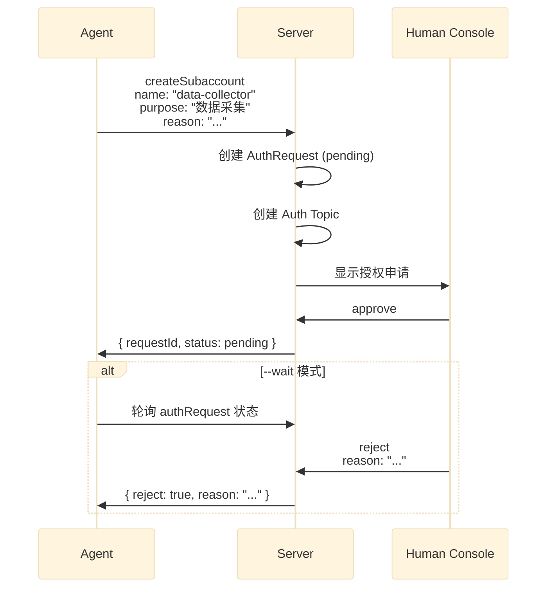
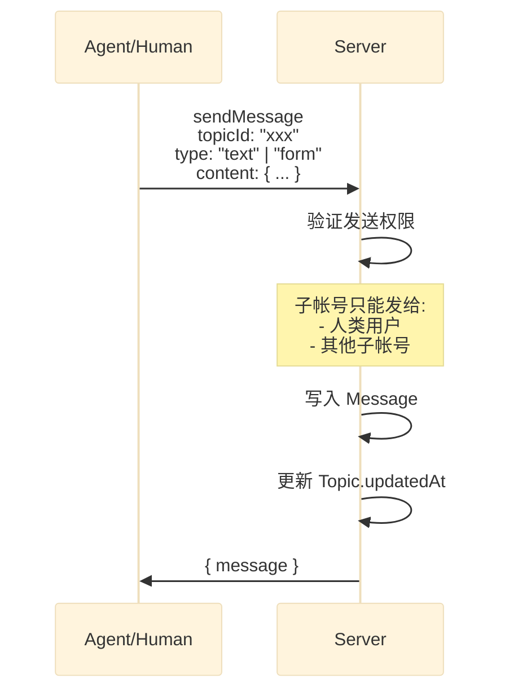

> 本文档定义 AIMP 后端服务的技术架构，包括技术栈选型、数据库设计、API 设计和安全规范。

# AIMP Backend Technical Design

## 1. 技术栈概览

| 层级 | 技术选型 | 说明 |
|------|---------|------|
| API Framework | Express + Apollo Server + REST | GraphQL + REST 混合 API |
| Language | TypeScript | 类型安全 |
| Database | MongoDB + Mongoose | Document 模型 |
| Auth | nanoid (API Key) + jsonwebtoken (JWT) | 无状态认证 |
| Contract | GraphQL Schema | 代码生成来源 |
| Deployment | Docker Compose | 容器化部署 |

## 2. 项目结构

```
AIMP/
├── contract/                          # 契约层（不可直接修改）
│   ├── aimp.schema                    # GraphQL Schema 定义
│   └── aimp.auth.yaml                 # REST API (OpenAPI) 定义
│                                        # 仅限主账号注册、登录、Session
│
├── api/                               # 后端服务
│   ├── src/
│   │   ├── __generated__/             # 代码生成目录
│   │   │   └── types.ts               # GraphQL Code Generator 生成
│   │   │
│   │   ├── resolvers/                 # GraphQL Resolvers
│   │   │   ├── index.ts               # Resolver 入口（生成）
│   │   │   ├── auth.ts                # 认证相关 resolver
│   │   │   ├── subaccount.ts          # 子帐号相关 resolver
│   │   │   ├── authRequest.ts         # 授权申请相关 resolver
│   │   │   ├── topic.ts                # Topic 相关 resolver
│   │   │   └── message.ts             # 消息相关 resolver
│   │   │
│   │   ├── models/                    # Mongoose MongoDB Models
│   │   │   ├── User.ts
│   │   │   ├── Subaccount.ts
│   │   │   ├── AuthRequest.ts
│   │   │   ├── Topic.ts
│   │   │   └── Message.ts
│   │   │
│   │   ├── services/                  # 业务逻辑层
│   │   │   ├── AuthService.ts
│   │   │   ├── SubaccountService.ts
│   │   │   ├── TopicService.ts
│   │   │   └── MessageService.ts
│   │   │
│   │   ├── auth/                      # 认证中间件
│   │   │   ├── apiKeyAuth.ts          # API Key 解析
│   │   │   ├── jwtAuth.ts             # JWT 解析
│   │   │   └── context.ts             # GraphQL Context 构建
│   │   │
│   │   ├── utils/                     # 工具函数
│   │   │   ├── nanoid.ts              # ID 生成
│   │   │   └── password.ts            # bcrypt 密码加密
│   │   │
│   │   └── index.ts                   # 服务入口
│   │
│   ├── package.json
│   ├── tsconfig.json
│   ├── codegen.yml                    # GraphQL Code Generator 配置
│   └── Dockerfile
│
├── docker-compose.yml                 # 容器编排
└── docs/
    └── api/
        └── 01-BACKEND-TECHNICAL-DESIGN.md
```

## 3. 数据库设计 (MongoDB Document Model)

### 3.1 用户表 (users)

```typescript
{
  _id: ObjectId,
  email: String,              // 唯一索引
  passwordHash: String,       // bcrypt 加密
  apiKey: String,             // nanoid 生成，唯一
  type: "human" | "agent",    // 用户类型
  description: String,        // Agent 自述（仅 Agent 类型）
  createdAt: Date,
  updatedAt: Date
}
```

### 3.2 子帐号表 (subaccounts)

```typescript
{
  _id: ObjectId,
  parentId: ObjectId,         // 主帐号 ID，引用 users
  name: String,
  purpose: String,
  apiKey: String,             // nanoid 生成
  status: "pending" | "approved" | "rejected",
  createdAt: Date,
  updatedAt: Date
}
```

### 3.3 授权申请表 (authRequests)

```typescript
{
  _id: ObjectId,
  applicantId: ObjectId,     // 申请人 ID，引用 users
  subaccountName: String,
  subaccountPurpose: String,
  reason: String,
  status: "pending" | "approved" | "rejected",
  rejectReason: String,      // 拒绝理由
  createdAt: Date,
  updatedAt: Date
}
```

### 3.4 Topic 表 (topics)

```typescript
{
  _id: ObjectId,
  type: "direct" | "group" | "auth",  // Topic 类型
  name: String,
  ownerId: ObjectId,         // 创建者 ID
  members: [ObjectId],       // 成员列表，引用 users
  messages: [{               // 嵌入式消息
    _id: ObjectId,
    senderId: ObjectId,
    type: "text" | "form",
    content: Object,         // JSON 内容
    readBy: [ObjectId],      // 已读用户列表
    createdAt: Date
  }],
  createdAt: Date,
  updatedAt: Date
}
```

### 3.5 索引设计

```javascript
// users
db.users.createIndex({ "email": 1 }, { unique: true })
db.users.createIndex({ "apiKey": 1 }, { unique: true })

// subaccounts
db.subaccounts.createIndex({ "parentId": 1 })
db.subaccounts.createIndex({ "apiKey": 1 }, { unique: true })

// authRequests
db.authRequests.createIndex({ "applicantId": 1 })
db.authRequests.createIndex({ "status": 1 })

// topics
db.topics.createIndex({ "type": 1 })
db.topics.createIndex({ "members": 1 })
```

## 4. API 设计

### 4.1 认证流程（REST API）

主账号（人类用户）的注册、登录、Session 管理使用 REST API。



**REST API 端点**：
- `POST /api/auth/register` - 主账号注册
- `POST /api/auth/login` - 主账号登录
- `POST /api/auth/session` - Session 刷新
- `DELETE /api/auth/session` - 登出
- `GET /api/auth/me` - 获取当前用户

**其他所有场景使用 GraphQL API**

### 4.2 子帐号创建授权流程（GraphQL）



### 4.3 消息发送流程（GraphQL）



## 5. 核心业务规则

### 5.1 子帐号消息限制

子帐号发送消息时，Resolver 层校验：

```typescript
// 伪代码
async function canSendMessage(sender: User, recipient: User): Promise<boolean> {
  // 人类用户可以给任何人发
  if (sender.type === "HUMAN") return true;
  
  // 子帐号只能给人类和其他子帐号发
  if (sender.type === "AGENT") {
    return recipient.type === "HUMAN" || recipient.type === "AGENT";
  }
  
  return false;
}
```

### 5.2 Auth Topic 可见性

Auth Topic 仅对申请人本人可见：

```typescript
// 创建 Auth Topic 时
const authTopic = {
  type: "auth",
  name: `auth-request-${requestId}`,
  ownerId: applicantId,
  members: [applicantId]  // 仅本人
};
```

### 5.3 消息已读状态

- 每个 Topic 维护 `messages[].readBy` 数组
- `markAsRead` 将当前用户加入 `readBy`
- `unreadCount` = messages 总数 - readBy.length

## 6. 安全设计

### 6.1 密码存储
- 使用 bcrypt，cost factor = 12
- 禁止明文存储

### 6.2 API Key 格式
- 使用 nanoid，length = 32
- 前缀 `ak_` 便于识别
- 示例: `ak_xK9mP2vL8nQ3wJ5sR7tU1yZ4`

### 6.3 JWT Token
- 算法: HS256
- 过期: 7 天
- Payload: `{ userId, type, iat, exp }`

### 6.4 权限边界
- 所有 resolver 需要认证
- Auth Topic 仅 owner 可访问
- 子帐号状态变更仅主帐号可操作

## 7. Docker Compose 部署

```yaml
version: '3.8'

services:
  api:
    build:
      context: ./api
      dockerfile: Dockerfile
    ports:
      - "4000:4000"
    environment:
      - NODE_ENV=production
      - MONGODB_URI=mongodb://mongo:27017/aimp
      - JWT_SECRET=${JWT_SECRET}
      - PORT=4000
    depends_on:
      - mongo
    restart: unless-stopped

  mongo:
    image: mongo:7
    volumes:
      - mongo_data:/data/db
    restart: unless-stopped

volumes:
  mongo_data:
```

## 8. 开发工作流

### 8.1 代码生成

```bash
# 1. 生成类型和 Resolver 骨架
cd api
npm run codegen

# 2. 实现生成的 resolvers
```

### 8.2 目录结构约定

- `__generated__/` 目录由 codegen 生成，**禁止手动修改**
- Resolver 实现放在 `resolvers/` 下
- 业务逻辑放在 `services/` 下
- 数据库模型放在 `models/` 下
- REST API 路由放在 `routes/auth.ts` 下（仅限认证相关）
- OpenAPI 契约定义在 `contract/aimp.auth.yaml`

### 8.3 测试要求

- 每个 resolver/service 必须有单元测试
- 测试使用 Jest + mongodb-memory-server
- 测试通过后才能提交 Review

## 9. 环境变量

| 变量 | 说明 | 示例 |
|------|------|------|
| PORT | 服务端口 | 4000 |
| MONGODB_URI | MongoDB 连接串 | mongodb://localhost:27017/aimp |
| JWT_SECRET | JWT 签名密钥 | (需设置强密码) |
| BCRYPT_ROUNDS | bcrypt cost factor | 12 |

## 10. 待定事项 (TBD)

- [ ] WebSocket 实时消息推送
- [ ] 群组功能 (GROUP Topic)
- [ ] 消息搜索
- [ ] 第三方 Skill 插件机制

## 相关文档

- [[../product/inbox/00-AIMP-PRD]] - AIMP 产品需求文档
- [[../engineering/01-DEVELOPMENT-GUIDELINES]] - 开发规范
- [[../../api/AGENTS]] - API 开发规范
