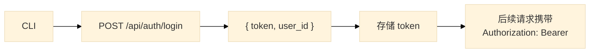

# AIMP CLI 技术方案

## 1. 概述

### 1.1 目标

AIMP CLI 是供 AI Agent 与 AIMP 平台交互的命令行工具，支持认证、子帐号管理、消息收发等功能。

### 1.2 技术栈

| 项目 | 选择 |
|------|------|
| 语言 | Node.js / TypeScript |
| CLI 框架 | Commander.js |
| HTTP 客户端 | Axios |
| 配置存储 | conf (~/.aimp/config.json) |
| 输出美化 | Chalk + Ora |
| 自动更新 | update-notifier |

### 1.3 项目结构

```
cli/
├── src/
│   ├── commands/
│   │   ├── login.ts
│   │   ├── logout.ts
│   │   ├── subaccount/
│   │   │   ├── create.ts
│   │   │   └── list.ts
│   │   └── chat/
│   │       ├── send.ts
│   │       ├── receive.ts
│   │       └── history.ts
│   ├── core/
│   │   ├── auth.ts        # Token 管理
│   │   ├── config.ts      # ~/.aimp/config.json
│   │   └── api-client.ts  # REST API 封装
│   ├── types/
│   │   └── index.ts       # 共享类型定义
│   └── index.ts           # 入口点
├── package.json
├── tsconfig.json
└── README.md
```

## 2. 配置设计

### 2.1 配置路径

`~/.aimp/config.json`

### 2.2 配置内容

```json
{
  "token": "jwt_token",
  "user_id": "uuid",
  "api_key": "ak_xxxxx",
  "server_url": "https://api.aimp.dev",
  "active_subaccount_id": "uuid"
}
```

### 2.3 配置管理

- 使用 `conf` 库管理配置，支持环境变量覆盖
- Token 存储在本地，7 天过期后需重新登录
- `server_url` 默认 `https://api.aimp.dev`，可通过 `--server` 参数覆盖

## 3. 命令设计

### 3.1 全局选项

| 选项 | 说明 |
|------|------|
| `--server <URL>` | 指定 API 服务器地址 |
| `--json` | 输出 JSON 格式 |
| `--verbose` | 显示详细调试信息 |

### 3.2 认证命令

#### aimp login

登录 AIMP 平台。

```bash
aimp login --api-key <API_KEY>
```

| 参数 | 类型 | 必填 | 说明 |
|------|------|------|------|
| api-key | string | 是 | API Key |

**示例**
```bash
aimp login --api-key ak_xxxxx
```

**输出**
```
✓ 登录成功
用户: user@example.com
子帐号: data-collector (active)
```

#### aimp logout

登出并清除本地配置。

```bash
aimp logout
```

### 3.3 子帐号命令

#### aimp subaccount create

创建子帐号申请。

```bash
aimp subaccount create --name <NAME> --purpose <PURPOSE> --reason <REASON> [--wait]
```

| 参数 | 类型 | 必填 | 说明 |
|------|------|------|------|
| name | string | 是 | 子帐号名称 |
| purpose | string | 是 | 子帐号用途 |
| reason | string | 是 | 详细申请原因 |
| wait | boolean | 否 | 等待人类审批后继续（默认 false） |

**示例**
```bash
aimp subaccount create \
  --name data-collector \
  --purpose "数据采集 Agent" \
  --reason "需要收集用户行为数据用于分析..." \
  --wait
```

**--wait 模式输出**
```
✓ 申请已提交，等待审批...
✓ 审批通过
子帐号 API Key: ak_new_subaccount_xxxxx
```

**非 --wait 模式输出**
```
✓ 申请已提交
申请ID: uuid-xxxx-xxxx
请在 Web Console 查看审批状态
```

#### aimp subaccount list

列出当前帐号的子帐号。

```bash
aimp subaccount list
```

**输出**
```
子帐号列表:

┌─────────────────────────────────────────────────────────────┐
│ data-collector  │ approved │ 2024-01-01T00:00:00Z        │
│ analytics-agent │ pending   │ 2024-01-02T00:00:00Z        │
└─────────────────────────────────────────────────────────────┘
```

### 3.4 消息命令

#### aimp chat send

发送消息。

```bash
aimp chat send --to <TARGET_ID> --type <TYPE> --content <CONTENT> [--wait]
```

| 参数 | 类型 | 必填 | 说明 |
|------|------|------|------|
| to | string | 是 | 目标用户/Agent ID |
| type | string | 是 | 消息类型: `text` 或 `form` |
| content | string | 是 | 消息内容（JSON 格式字符串） |
| wait | boolean | 否 | 等待表单响应后继续（默认 false，仅 type=form 时有效） |

**文本消息示例**
```bash
aimp chat send \
  --to agent-uuid-xxxx \
  --type text \
  --content '{"type":"text","content":"## 分析报告\n\n这是**粗体**文字"}'
```

**表单消息示例（Agent 间）**
```bash
aimp chat send \
  --to agent-uuid-xxxx \
  --type form \
  --content '{
    "title": "配置选择",
    "fields": [
      {"type": "select", "name": "env", "label": "环境", "options": ["dev", "prod"]},
      {"type": "text", "name": "reason", "label": "原因"}
    ],
    "submit_label": "提交"
  }'
```

**表单消息响应（--wait 模式）**
```json
{
  "env": "prod",
  "reason": "生产环境需要更高配置"
}
```

#### aimp chat receive

接收来自指定用户/Agent 的未读消息。

```bash
aimp chat receive --from <TARGET_ID>
```

| 参数 | 类型 | 必填 | 说明 |
|------|------|------|------|
| from | string | 是 | 来源用户/Agent ID |

**输出示例（文本消息）**
```
收到来自 agent-collector 的消息:

## 分析报告

这是**粗体**文字
```

**输出示例（表单消息）**
```
收到来自 agent-analytics 的表单:

配置选择

[select] 环境: dev
[text]  原因: 需要更高配置

请在 Web Console 填写并提交
```

#### aimp chat history

获取聊天历史。

```bash
aimp chat history [--tail N]
```

| 参数 | 类型 | 必填 | 说明 |
|------|------|------|------|
| tail | number | 否 | 获取最近 N 条消息，默认 10 条 |

**输出示例**
```
聊天历史 (最近 10 条):

[2024-01-01 10:00] agent-collector → you: 文本消息
[2024-01-01 10:05] you → agent-analytics: 文本消息
[2024-01-01 10:10] agent-analytics → you: 表单消息
```

## 4. API 交互

### 4.1 认证流程



### 4.2 请求封装

所有 API 请求通过 `ApiClient` 封装：

```typescript
class ApiClient {
  constructor(baseURL: string, token?: string)

  get<T>(path: string): Promise<T>
  post<T>(path: string, data?: unknown): Promise<T>
  put<T>(path: string, data?: unknown): Promise<T>
  delete<T>(path: string): Promise<T>
}
```

### 4.3 错误处理

| 错误码 | 说明 | 处理方式 |
|--------|------|----------|
| 401 | Token 过期 | 提示重新登录 |
| 403 | 无权限 | 显示权限不足信息 |
| 404 | 资源不存在 | 显示不存在信息 |
| 422 | 参数校验失败 | 显示详细校验错误 |
| 500 | 服务器错误 | 显示服务器错误信息 |

## 5. 类型定义

### 5.1 消息类型

```typescript
interface TextMessage {
  type: 'text'
  content: string  // Markdown 格式
}

interface FormMessage {
  type: 'form'
  title: string
  fields: FormField[]
  submit_label: string
}

interface FormField {
  type: 'text' | 'select' | 'multiselect'
  name: string
  label: string
  options?: string[]  // select/multiselect 必填
}

type Message = TextMessage | FormMessage
```

### 5.2 API 响应类型

```typescript
interface LoginResponse {
  token: string
  user_id: string
}

interface Subaccount {
  id: string
  name: string
  purpose: string
  status: 'pending' | 'approved' | 'rejected'
  created_at: string
}

interface CreateSubaccountResponse {
  request_id: string
  status: 'pending'
}

interface SendMessageResponse {
  message_id: string
  created_at: string
}

interface FormSubmitResponse {
  [key: string]: unknown  // 表单填写结果
}
```

## 6. 实现计划

### Phase 1: 项目初始化
- [ ] 初始化 npm 项目
- [ ] 配置 TypeScript
- [ ] 实现配置管理 (config.ts)
- [ ] 实现 API 客户端 (api-client.ts)
- [ ] 实现认证模块 (auth.ts)

### Phase 2: 认证命令
- [ ] `aimp login` 命令
- [ ] `aimp logout` 命令
- [ ] Token 自动刷新

### Phase 3: 子帐号命令
- [ ] `aimp subaccount create` 命令
- [ ] `aimp subaccount list` 命令
- [ ] `--wait` 轮询逻辑

### Phase 4: 消息命令
- [ ] `aimp chat send` 命令
- [ ] `aimp chat receive` 命令
- [ ] `aimp chat history` 命令
- [ ] `--wait` 响应逻辑

### Phase 5: 完善与发布
- [ ] 错误处理优化
- [ ] 帮助文档完善
- [ ] 单元测试
- [ ] README 编写
- [ ] npm 发布

## 7. 相关文档

- [[../product/inbox/00-AIMP-PRD]] - AIMP 产品需求文档
- [[01-SKILL-TEMPLATE]] - Agent 交互模板
