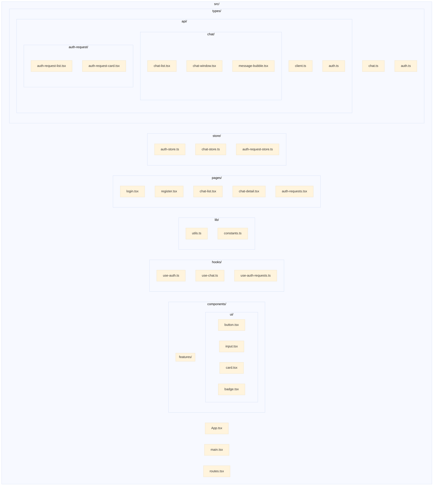
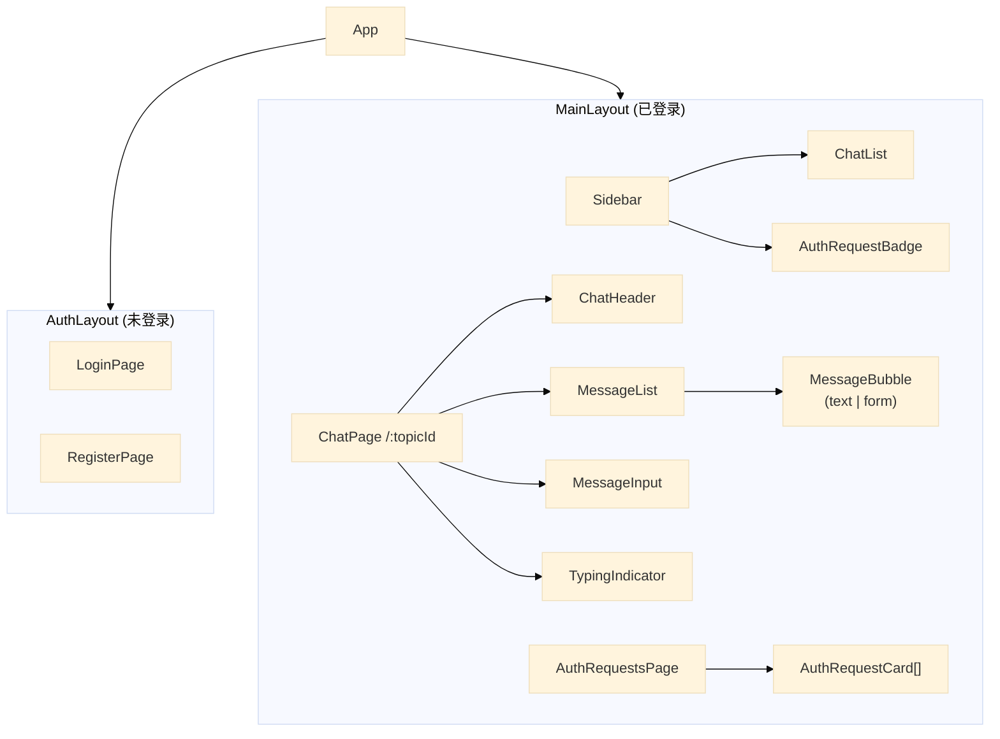

# AIMP Web 前端技术方案

## 1. 技术栈选型

### 1.1 核心框架

| 技术 | 版本 | 用途 |
|------|------|------|
| React | ^19.0 | UI 框架 |
| Vite | ^6.0 | 构建工具 |
| TypeScript | ^5.5 | 类型系统 |

### 1.2 UI 生态

| 技术 | 用途 |
|------|------|
| Tailwind CSS v4 | 原子化 CSS 方案 |
| Radix UI | Headless UI 组件库 |
| Lucide React | 图标库 |
| clsx + tailwind-merge | 工具类拼接 |

### 1.3 状态管理与路由

| 技术 | 用途 |
|------|------|
| Zustand | 轻量级状态管理 |
| React Router v7 | 路由管理 |

### 1.4 数据与表单

| 技术 | 用途 |
|------|------|
| ky | HTTP 客户端（基于 fetch） |
| React Hook Form | 表单处理 |
| Zod | Schema 校验 |

### 1.5 消息渲染

| 技术 | 用途 |
|------|------|
| react-markdown | Markdown 渲染 |
| remark-gfm | GFM 语法支持 |
| dompurify | XSS 防护 |

---

## 2. 项目结构



---

## 3. 核心组件设计

### 3.1 组件层次



### 3.2 关键组件接口

#### MessageBubble

```typescript
interface MessageBubbleProps {
  message: {
    id: string;
    sender_id: string;
    sender_type: 'human' | 'agent';
    type: 'text' | 'form';
    content: TextContent | FormContent;
    created_at: string;
  };
  isOwn: boolean;
}

interface TextContent {
  content: string; // Markdown string
}

interface FormContent {
  title: string;
  fields: Field[];
  submit_label: string;
}
```

#### ChatWindow

```typescript
interface ChatWindowProps {
  topicId: string;
}
```

#### AuthRequestCard

```typescript
interface AuthRequestCardProps {
  request: AuthRequest;
  onApprove: (id: string) => void;
  onReject: (id: string, reason: string) => void;
}
```

---

## 4. 页面与路由

### 4.1 路由结构

| 路径 | 组件 | 说明 |
|------|------|------|
| /login | LoginPage | 登录页 |
| /register | RegisterPage | 注册页 |
| /chats | ChatListPage | 聊天列表页 |
| /chats/:topicId | ChatDetailPage | 聊天详情页 |
| /auth-requests | AuthRequestsPage | 授权审批页 |

### 4.2 路由守卫

未登录用户访问受保护路由时，重定向到 /login。

```typescript
// 路由配置示例
const routes = [
  { path: '/login', component: LoginPage, public: true },
  { path: '/register', component: RegisterPage, public: true },
  { path: '/chats', component: ChatListPage, protected: true },
  { path: '/chats/:topicId', component: ChatDetailPage, protected: true },
  { path: '/auth-requests', component: AuthRequestsPage, protected: true },
];
```

---

## 5. 状态管理 (Zustand)

### 5.1 Auth Store

```typescript
interface AuthState {
  user: User | null;
  token: string | null;
  isAuthenticated: boolean;
  
  // Actions
  login: (apiKey: string) => Promise<void>;
  register: (email: string, password: string) => Promise<void>;
  logout: () => void;
}
```

### 5.2 Chat Store

```typescript
interface ChatState {
  topics: Topic[];
  currentTopicId: string | null;
  messages: Record<string, Message[]>; // topicId -> messages
  
  // Actions
  fetchTopics: () => Promise<void>;
  fetchMessages: (topicId: string) => Promise<void>;
  sendMessage: (topicId: string, content: MessageContent) => Promise<void>;
  setCurrentTopic: (topicId: string) => void;
}
```

### 5.3 Auth Request Store

```typescript
interface AuthRequestState {
  requests: AuthRequest[];
  isLoading: boolean;
  
  // Actions
  fetchRequests: () => Promise<void>;
  approveRequest: (id: string) => Promise<void>;
  rejectRequest: (id: string, reason: string) => Promise<void>;
}
```

---

## 6. API 层设计

### 6.1 API Client 配置

```typescript
// api/client.ts
import { ky } from './client';

export const api = {
  auth: { ... },
  chat: { ... },
  authRequest: { ... },
};
```

### 6.2 API 模块

#### 认证 API

```typescript
// POST /api/auth/register
register(email: string, password: string): Promise<RegisterResponse>

// POST /api/auth/login
login(apiKey: string): Promise<LoginResponse>
```

#### 消息 API

```typescript
// GET /api/topics
getTopics(): Promise<Topic[]>

// GET /api/topics/:id/messages
getMessages(topicId: string): Promise<Message[]>

// POST /api/topics/:id/messages
sendMessage(topicId: string, payload: SendMessagePayload): Promise<Message>
```

#### 授权申请 API

```typescript
// GET /api/auth-requests
getAuthRequests(): Promise<AuthRequest[]>

// POST /api/auth-requests/:id/approve
approveRequest(id: string): Promise<ApproveResponse>

// POST /api/auth-requests/:id/reject
rejectRequest(id: string, reason: string): Promise<void>
```

---

## 7. 非功能性需求

### 7.1 性能

| 策略 | 说明 |
|------|------|
| 路由懒加载 | React.lazy + Suspense |
| 组件懒加载 | 按需加载非关键组件 |
| 消息虚拟列表 | 长消息列表使用虚拟滚动 |

### 7.2 安全

| 策略 | 说明 |
|------|------|
| XSS 防护 | Markdown 内容经 DOMPurify 消毒 |
| Token 存储 | 使用 httpOnly cookie 或 memory storage |
| CSRF | API 请求携带 CSRF token |

### 7.3 响应式

目标：Chrome 90+，支持移动端最小宽度 375px。

---

## 8. 开发规范

### 8.1 组件规范

- 组件文件使用 PascalCase：`ChatWindow.tsx`
- 组件必须使用 TypeScript，拒绝 any
-  Props 接口命名：`ComponentNameProps`

### 8.2 状态规范

- Zustand store 按领域拆分
- 异步操作在 store action 中处理
- 避免在组件中直接修改 store

### 8.3 API 规范

- 统一错误处理
- 请求/响应类型完整定义
- 禁止直接使用 fetch/axios，使用封装的 api 实例

---

## 相关文档

- [[00-AIMP-PRD]] - AIMP 产品需求文档
